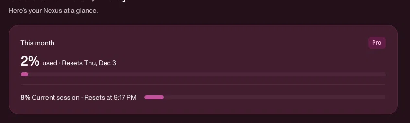

# dsh-nexus-usage-panel

Nexus usage dashboard panel for the [DeepSeek Harness](https://github.com/deepseek-ai) (DSH) Web GUI.
It mirrors the **Fireworks Nexus** desktop app's Overview card — plan tier badge, "This month — N% used · Resets <date>", and "N% Current session · Resets at <time>" with pink meters — as a **Nexus Usage** page in the DSH Web GUI.



## How it works

The panel reads the same private REST API that [nexus.fireworks.ai](https://nexus.fireworks.ai/) and the Nexus desktop app read — see [docs/research-api.md](docs/research-api.md) for the full endpoint map:

| Endpoint | Purpose |
|---|---|
| `GET /v1/accounts/{account}/nexusPlans` | Active plan tier + billing period |
| `GET /v1/accounts/{account}/users/{user}/nexusPlanUsage` | `monthly` and 5-hour `rollingWindow` usage percents + reset times |
| `POST /v1/accounts/{account}/usageCosts:query` | (Milestone 2) per-day, per-model spend |

Auth uses the per-machine key the Nexus desktop app minted at sign-in, stored in the **macOS login keychain** (service `FireworksAI`, account `fireworks-api-key`). The key never leaves the host process; the browser only ever sees sanitized percentages. Overrides: `FIREWORKS_NEXUS_KEY` env or the plugin's `apiKey` config; gateway override via `NEXUS_GATEWAY_URL` / `gatewayBase` config.

Note: the API exposes **percentages of your plan limits only** — dollar allowances are not disclosed to members. DSH sessions themselves run through Nexus Auto (`api.fireworks.ai/inference/v1`, model `auto`); Fireworks routes server-side and does not echo the routed model id to the client.

## Install

```sh
# In a DSH profile (or via the Plugins page):
pnpm add dsh-nexus-usage-panel
```

Or in the DSH Web GUI: **Plugins → Install**, spec `dsh-nexus-usage-panel`. Then reload; open **Settings → Nexus Usage**.

From GitHub without npm: **Plugins → Install** with spec
`github:bradywatkinson/dsh-nexus-usage-panel`.

Via the experimental **Discover** tab (custom plugin markets): add index source
`https://raw.githubusercontent.com/bradywatkinson/dsh-nexus-usage-panel/main/market/index.json`
and install **Nexus Usage** from the card. The index is format-1, validated with `@deepseek-ai/dsh-plugin-market-index`.

- macOS only for the keychain read (the Nexus desktop app must be signed in once).
- One gateway read per minute (cached); each of plan/seat fails independently, like the app.

## Development

```sh
npm test          # host shaping + client smoke
```

Repo layout: `lib/index.js` (host: cordis plugin, serves `/api/dsh-nexus-usage/usage`), `lib/client.js` (browser module: the dashboard card in the `settings.section` slot), `cordis.patch.yml` (bundle row).

## Roadmap

- Issues: https://github.com/bradywatkinson/dsh-nexus-usage-panel/issues
- Milestone 2 (#3): per-model/token breakdown via `usageCosts:query`.

## License

MIT
